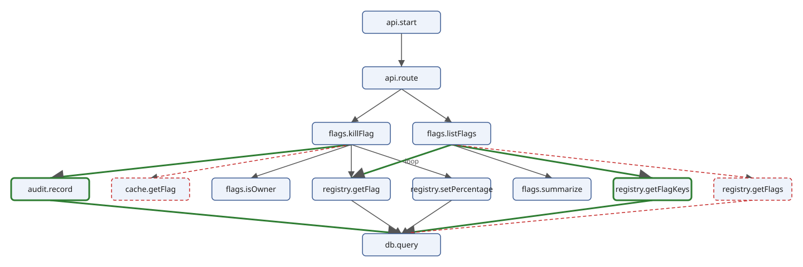

# Comparing Two Versions

<!-- examples: call-chains -->

The call graphs of [A Call Graph from the Code](call-chains-graph.md)
say which function calls which. A change is easier to judge by its
*call chains*: the paths through the graph from where the service is
entered to the functions at the end, each one a thing that happens when
a request comes in. This section lists the chains of both versions,
compares the graphs and the chains, and writes what changed as a text
report, an HTML page and a drawing.

## Entries and next calls

A chain starts at an *entry*, a function that no call of the program
reaches, and the graph's queries found one: `api.start`. A chain is
a sequence of `call` elements, each going on from where the one before
it ended. What can follow a chain are the calls of its last function to
functions of the program; external calls such as `fetch` end a chain
and are not part of it:

```xquery
{{#include ../examples/call-chains/graph.xqm:next}}
```

The test `not(@to = $chain/@from)` keeps a chain from going through a
function twice. The Vane service has no cycles, but a program with a
function that calls itself, or two that call each other, would
otherwise have chains without end.

## Chains with a worklist

The chains can be made without a function that calls itself: keep a
list of the chains that are not finished, the *worklist*, and take one
chain off it at a time. A chain that cannot go on is finished; any
other is put back once for each next call, one call longer. When the
worklist is empty, every chain is finished:

```xquery
{{#include ../examples/call-chains/graph.xqm:chains}}
```

The state of the loop is a map with the worklist, an array of chains,
and the finished chains. `fn:while-do` takes a start value, a condition
and an action: it applies the action as long as the condition holds and
returns the last value. Putting the longer chains at the front of the
worklist goes deep first, so the chains come out in the order of the
calls in the code.

`graph:chain-text` writes a chain as the functions it goes through,
with a star after a function called in a loop:

```xquery
{{#include ../examples/call-chains/graph.xqm:chain-text}}
```

`chains.xq` prints the chains of a directory:

```xquery
{{#include ../examples/call-chains/chains.xq}}
```

```console
$ sxml xquery --allow-file-access --param=directory=before chains.xq
api.start > api.route > flags.listFlags > registry.getFlags > db.query
api.start > api.route > flags.listFlags > flags.summarize
api.start > api.route > flags.killFlag > cache.getFlag
api.start > api.route > flags.killFlag > registry.getFlag > db.query
api.start > api.route > flags.killFlag > flags.isOwner
api.start > api.route > flags.killFlag > registry.setPercentage > db.query
$ sxml xquery --allow-file-access --param=directory=after chains.xq
api.start > api.route > flags.listFlags > registry.getFlagKeys > db.query
api.start > api.route > flags.listFlags > registry.getFlag* > db.query
api.start > api.route > flags.listFlags > flags.summarize
api.start > api.route > flags.killFlag > registry.getFlag > db.query
api.start > api.route > flags.killFlag > flags.isOwner
api.start > api.route > flags.killFlag > registry.setPercentage > db.query
api.start > api.route > flags.killFlag > audit.record > db.query
```

Six chains before, seven after. Every chain that reaches PostgreSQL
ends in `db.query`, the one function that holds the pool, and
`cache.getFlag`, which reads Redis through a client of its own, ended a
chain of its own. The new chain through `audit.record` ends in
`db.query` too: the module's call to the owners' webhook is `fetch`, an
external call, which ends no chain and is not part of one.

## Chains with recursion

The same chains come from a function that calls itself, and it is
shorter: the chains that go on from a chain are, for each next call,
the chains that go on from the longer chain, and a chain that cannot go
on is one chain:

```xquery
{{#include ../examples/call-chains/graph.xqm:recursive}}
```

Both are correct, and give the same chains in the same order:

```console
$ sxml xquery --allow-file-access --param=directory=after chains.xq > worklist.txt
$ sxml xquery --allow-file-access --param=directory=after --param=method=recursive chains.xq > recursive.txt
$ cmp worklist.txt recursive.txt && echo same
same
```

The recursion is the definition of a chain written down. The worklist
says how the chains are made, step by step, and holds its state in a
value, so it can be stopped, counted or limited without changing the
definition: a maximum chain length is one more condition in the
`while-do`. For a graph with thousands of functions, the worklist also
keeps the depth of nested function calls flat.

## The diff

`diff.xq` compares two versions. It makes one document with every
function, call and chain of either version, each marked with an
attribute `change`: `added` when only the new version has it, `removed`
when only the old one has it, `changed` when both have it and it
differs, and no attribute when it is the same.

A call of the graph is a call site, with a line. Lines move when code
is added above them, so the diff compares calls by caller and callee
only, one for each pair, repeated when any of its call sites is in a
loop:

```xquery
{{#include ../examples/call-chains/diff.xq:calls}}
```

A chain is compared by the functions it goes through, without the
stars, so that a chain whose call became repeated is `changed`:

```xquery
{{#include ../examples/call-chains/diff.xq:chains}}
```

One function compares two maps of either kind. It goes through the keys
of both, in order, and copies the item of the new version, or of the
old one when the new one does not have it, with the change as an
attribute. `deep-equal` on two elements compares their names,
attributes and content:

```xquery
{{#include ../examples/call-chains/diff.xq:compare}}
```

The diff of the functions is the same function on two maps from id to
an empty `function` element. The main expression puts the three
together:

```xquery
{{#include ../examples/call-chains/diff.xq:main}}
```

`local:modules` is the last part, below. The two versions are external
variables, `before` and `after` unless they are given:

```console
$ sxml xquery --allow-file-access diff.xq --output=diff.xml
$ sxml xpath --context-item=diff.xml 'for $kind in ("function", "call", "chain") return `{$kind}s: {count(/diff/*[local-name() = $kind][@change = "added"])} added, {count(/diff/*[local-name() = $kind][@change = "removed"])} removed`'
"functions: 2 added, 2 removed"
"calls: 7 added, 5 removed"
"chains: 3 added, 2 removed"
```

The calls that changed:

```console
$ sxml xpath --context-item=diff.xml '/diff/call[@change] ! `{@change}: {@from} > {@to}{if (@repeated) then " (in a loop)" else ""}`'
"added: audit.record > JSON.stringify"
"added: audit.record > db.query"
"added: audit.record > fetch"
"removed: cache.getFlag > JSON.parse"
"removed: cache.getFlag > client.get"
"added: flags.killFlag > audit.record"
"removed: flags.killFlag > cache.getFlag"
"added: flags.listFlags > registry.getFlag (in a loop)"
"added: flags.listFlags > registry.getFlagKeys"
"removed: flags.listFlags > registry.getFlags"
"added: registry.getFlagKeys > db.query"
"removed: registry.getFlags > db.query"
```

`flags.listFlags > registry.getFlag` is `added`, not `changed`: before
the change, `listFlags` did not call `getFlag` at all.

## How often a module is called

The question a reviewer asks of this change is how much more work a
request makes, and that is a question about modules: a call to the
registry module is a query to PostgreSQL, a call to the audit module a
query and a request to the owners' webhook, a call to the cache module
a read from Redis. For each function of both versions and each other module it
calls, `local:modules` counts the calls before and after. A call in a
loop counts as *n*, once per iteration:

```xquery
{{#include ../examples/call-chains/diff.xq:modules}}
```

The `group by` of the calls in `local:calls` is gone here: two calls to
the same function are two calls. `$module-of` and `$calls` are inline
functions bound with `let`, used as helpers inside one function. The
result is the end of `diff.xml`:

```console
$ sxml xpath --context-item=diff.xml '/diff/module ! `{@from} > {@name}: {@old} -> {@new}`'
"flags.listFlags > registry: 1 -> 1 + n"
"flags.killFlag > audit: 0 -> 1"
"flags.killFlag > cache: 1 -> 0"
```

That is the prediction: listing the flags calls the registry module,
and so PostgreSQL, once more for each flag, and the kill switch calls
the audit module once and the cache module no more.

## A text report

`report.xq` writes the diff for a terminal or a review comment. It
reads `diff.xml` as its context item and only formats:

```xquery
{{#include ../examples/call-chains/report.xq}}
```

```console
$ sxml xquery --context-item=diff.xml report.xq
functions added:
  audit.record
  registry.getFlagKeys

functions removed:
  cache.getFlag
  registry.getFlags

calls added:
  audit.record > JSON.stringify
  audit.record > db.query
  audit.record > fetch
  flags.killFlag > audit.record
  flags.listFlags > registry.getFlag (in a loop)
  flags.listFlags > registry.getFlagKeys
  registry.getFlagKeys > db.query

calls removed:
  cache.getFlag > JSON.parse
  cache.getFlag > client.get
  flags.killFlag > cache.getFlag
  flags.listFlags > registry.getFlags
  registry.getFlags > db.query

chains added:
  api.start > api.route > flags.killFlag > audit.record > db.query
  api.start > api.route > flags.listFlags > registry.getFlag* > db.query
  api.start > api.route > flags.listFlags > registry.getFlagKeys > db.query

chains removed:
  api.start > api.route > flags.killFlag > cache.getFlag
  api.start > api.route > flags.listFlags > registry.getFlags > db.query

Calls to other modules, before and after:
  flags.listFlags > registry: 1 -> 1 + n
  flags.killFlag > audit: 0 -> 1
  flags.killFlag > cache: 1 -> 0
```

## An HTML report

`report.xsl` writes the same diff as a page: the calls that changed in
a table, every chain with the changed ones marked, and the calls to
other modules. A template rule for each kind of element, and the
classes `added`, `removed` and `changed` for the style sheet to colour:

```xml
{{#include ../examples/call-chains/report.xsl}}
```

With `expand-text="yes"`, braces in text are text value templates, so
the braces of the CSS rules are doubled. The rule for `chain[@change]`
wins over the rule for `chain` because its pattern has a predicate,
which gives it a higher default priority.

```console
$ sxml transform report.xsl diff.xml --output=report.html
$ sed -n '/Calls to other modules/,/<\/table>/p' report.html
    <h2>Calls to other modules</h2>
    <table>
      <tr>
        <th>Function</th>
        <th>Module</th>
        <th>before</th>
        <th>after</th>
      </tr>
      <tr>
        <td><code>flags.listFlags</code></td>
        <td><code>registry</code></td>
        <td>1</td>
        <td>1 + n</td>
      </tr>
      <tr>
        <td><code>flags.killFlag</code></td>
        <td><code>audit</code></td>
        <td>0</td>
        <td>1</td>
      </tr>
      <tr>
        <td><code>flags.killFlag</code></td>
        <td><code>cache</code></td>
        <td>1</td>
        <td>0</td>
      </tr>
    </table>
```

## Drawing the diff

The drawing module of [Project: Drawing Diagrams with SVG](svg.md),
`draw.xqm`, draws any diagram description: `node` and `edge` elements,
each with an optional `class` that the drawing copies to its SVG group
and colours for `added`, `removed` and `changed`. This project's
directory has it, and the SVG project's main query `draw.xq`, as
symbolic links to the files in `../svg`, so the module stays one file.

So drawing the diff is writing it as a diagram. `diagram.xq` makes a
node for each function and an edge for each call within the program,
with the change as the class and the label `loop` on a repeated call:

```xquery
{{#include ../examples/call-chains/diagram.xq}}
```

`draw.xqm` puts the first node in the top row, so the functions are
ordered as the chains first go through them: `index-of` gives each
function its position in the distinct functions of all chains, and the
entry, `api.start`, comes first.

```console
$ sxml xquery --context-item=diff.xml diagram.xq --output=diagram.xml
$ sxml xquery --context-item=diagram.xml draw.xq --output=calls.svg
$ sxml xpath --context-item=calls.svg '//*:g[tokenize(@class) = ("added", "removed", "changed")] ! `{@class}: {@id}`'
"edge added: edge-audit.record-db.query"
"edge added: edge-flags.killFlag-audit.record"
"edge removed: edge-flags.killFlag-cache.getFlag"
"edge added: edge-flags.listFlags-registry.getFlag"
"edge added: edge-flags.listFlags-registry.getFlagKeys"
"edge removed: edge-flags.listFlags-registry.getFlags"
"edge added: edge-registry.getFlagKeys-db.query"
"edge removed: edge-registry.getFlags-db.query"
"node service added: node-audit.record"
"node service removed: node-cache.getFlag"
"node service added: node-registry.getFlagKeys"
"node service removed: node-registry.getFlags"
```



The added functions and calls are drawn green and thick, the removed
ones red and dashed, and the call in the loop is labelled. The rows of
the drawing are the boxes with the same `y`:

```console
$ sxml xpath --context-item=calls.svg 'for $y in distinct-values(//*:rect/@y) return `{$y}: {string-join(//*:g[*:rect/@y = $y]/*:text, ", ")}`'
"20: api.start"
"120: api.route"
"220: flags.killFlag, flags.listFlags"
"320: audit.record, cache.getFlag, flags.isOwner, registry.getFlag, registry.setPercentage, flags.summarize, registry.getFlagKeys, registry.getFlags"
"420: db.query"
```

The entry, the router, the two request handlers, the functions they
call, and `db.query` at the bottom, which every query to PostgreSQL
goes through. Before and after are one picture: in the fourth
row the new `audit.record` stands beside the old `cache.getFlag`, and
the new `getFlagKeys` beside the old `getFlags`, with `getFlag` among
the functions both versions call.

## What the traces will say

The diff predicts, from the code alone, that `GET /api/getFlags` makes
one call to the registry module, one query to PostgreSQL, and then one
more per flag; that killing a flag calls the audit module once, which
writes to PostgreSQL and calls the owners' webhook; and that it no
longer reads Redis. It cannot say how many flags there are, how long
each query takes, or whether a call of `killFlag` found its flag in the
cache before the change. [Project: Comparing Traces Before and After a
Change](traces.md) answers those from traces recorded by the running
service. The line they check is
`flags.listFlags > registry: 1 -> 1 + n`, and with four flags, one
query to PostgreSQL becomes five.
