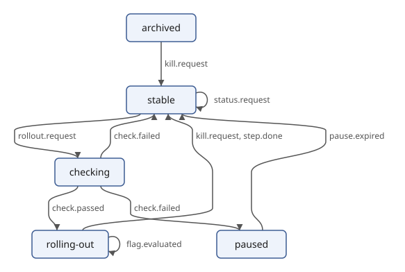
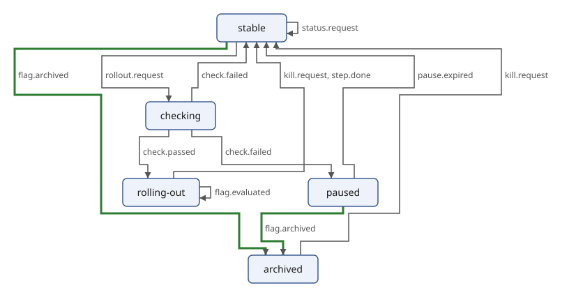

# Drawing the Machine

<!-- examples: scxml -->

A state machine is easiest to read as a picture: boxes for the states,
arrows for the transitions. [Project: Drawing Diagrams with SVG](svg.md)
built a module that draws any diagram description, `draw.xqm`, with a
computed layout. This section turns the machine into such a
description and draws it, and then draws what the fix of [Checking What
the Schema Cannot](scxml-checks.md) changed.

`draw.xqm` here is a link to the module in the `svg` directory, so the
machine is drawn by the same code as every other diagram of the book.

## The machine as a diagram

A diagram description is a `diagram` element with `node` and `edge`
elements, in no namespace. For the machine, each state is a node, and
each pair of states that transitions connect is an edge, labelled with
the events that lead from one to the other:

`machine-diagram.xq`:

```xquery
{{#include ../examples/scxml/machine-diagram.xq}}
```

- The initial state comes first, because the layout starts from the
  first node.
- The transitions are grouped by their source and target, so that two
  transitions between the same states make one arrow with both events
  on it; there is one arrow per pair, and `draw.xqm` gives each the id
  `edge-FROM-TO`.
- A transition without a target stays in its state, so it is an edge
  from the state to itself, which `draw.xqm` draws as a small loop.
- The edges are records, `record(from, to, label)`, so that the edges of
  two machines can be compared by their source and target, below.

```console
$ sxml xquery --context-item=flag.scxml machine-diagram.xq
<diagram title="feature_flag">
  <node id="stable" label="stable"/>
  <node id="checking" label="checking"/>
  <node id="rolling-out" label="rolling-out"/>
  <node id="paused" label="paused"/>
  <node id="archived" label="archived"/>
  <edge from="stable" to="checking" label="rollout.request"/>
  <edge from="stable" to="stable" label="status.request"/>
  <edge from="checking" to="rolling-out" label="check.passed"/>
  <edge from="checking" to="stable" label="check.failed"/>
  <edge from="checking" to="paused" label="check.failed"/>
  <edge from="rolling-out" to="stable" label="kill.request, step.done"/>
  <edge from="rolling-out" to="rolling-out" label="flag.evaluated"/>
  <edge from="paused" to="stable" label="pause.expired"/>
  <edge from="archived" to="stable" label="kill.request"/>
</diagram>
```

## Ranks with cycles

`draw.xqm` puts each node in a row by its *rank*: its distance, in
edges, from the start nodes, found breadth-first. A machine is full of
cycles (`stable` to `checking` and back), which is why the layout
can't use the longest path from the start, as a layout of a tree or a
pipeline might: in a cycle, paths have no longest. The breadth-first
distance is defined for every node a path reaches, cycles or not:

```console
$ sxml xquery --context-item=flag.scxml machine-diagram.xq \
  | sxml xquery --method=adaptive --context-item=- \
      --expression='import module namespace draw = "urn:example:draw" at "draw.xqm"; draw:ranks(/diagram)'
{"stable":0,"archived":0,"checking":1,"rolling-out":2,"paused":2}
```

`--context-item=-` reads the diagram from the pipe. `archived` has
rank 0, like `stable`: the start nodes are the first node *and* every
node without incoming edges, and no transition leads to `archived`. The
flaw that `check.xq` reported as "unreachable state: archived" is
visible in
the drawing: the state sits in the top row beside the initial state,
with arrows that leave it and none that arrive.

## Drawing it

`draw:svg` makes the SVG element; an output declaration indents it:

```console
$ sxml xquery --context-item=flag.scxml machine-diagram.xq > flag-diagram.xml
$ sxml xquery --context-item=flag-diagram.xml --output=flag.svg --expression='
    import module namespace draw = "urn:example:draw" at "draw.xqm";
    declare option output:indent "yes";
    draw:svg(/diagram)'
$ grep -A3 'id="node-' flag.svg
  <g class="node service" id="node-stable">
    <rect x="20" y="20" width="140" height="40" rx="6"/>
    <text x="90" y="45" text-anchor="middle">stable</text>
  </g>
  <g class="node service" id="node-checking">
    <rect x="110" y="120" width="140" height="40" rx="6"/>
    <text x="180" y="145" text-anchor="middle">checking</text>
  </g>
  <g class="node service" id="node-rolling-out">
    <rect x="20" y="220" width="140" height="40" rx="6"/>
    <text x="90" y="245" text-anchor="middle">rolling-out</text>
  </g>
  <g class="node service" id="node-paused">
    <rect x="200" y="220" width="140" height="40" rx="6"/>
    <text x="270" y="245" text-anchor="middle">paused</text>
  </g>
  <g class="node service" id="node-archived">
    <rect x="200" y="20" width="140" height="40" rx="6"/>
    <text x="270" y="45" text-anchor="middle">archived</text>
  </g>
```

The two states in the top row are `stable` and `archived`; the second
row has `checking` alone, and the third `rolling-out` and `paused`. The
transitions that stay are loops:

```console
$ grep -A3 'id="edge-stable-stable"' flag.svg
  <g class="edge" id="edge-stable-stable">
    <path d="M 40 60 C 40 84, 70 84, 70 60" marker-end="url(#arrow)"/>
    <text x="76" y="80">status.request</text>
  </g>
```



## Drawing a change

`machine-diagram.xq` takes an optional parameter, `before`: the file of
an earlier version of the machine. States and edges that the earlier
version doesn't have get the class `added`, and the ones only the
earlier version has get `removed`. `draw.xqm` copies the classes to the
SVG groups, and its style draws added parts in green and removed parts
dashed in red. The fixed machine against the seed:

```console
$ sxml xquery --context-item=flag-fixed.scxml --param=before=flag.scxml machine-diagram.xq \
  | sxml xquery --context-item=- --output=changes.svg --expression='
      import module namespace draw = "urn:example:draw" at "draw.xqm";
      declare option output:indent "yes";
      draw:svg(/diagram)'
$ grep -A3 'class="edge added"' changes.svg
  <g class="edge added" id="edge-stable-archived">
    <line x1="180" y1="60" x2="270" y2="120" marker-end="url(#arrow)"/>
    <text x="231" y="94">flag.archived</text>
  </g>
--
  <g class="edge added" id="edge-paused-archived">
    <line x1="300" y1="220" x2="300" y2="160" marker-end="url(#arrow)"/>
    <text x="306" y="194">flag.archived</text>
  </g>
```



The two new transitions on `flag.archived` are the change, and they
move `archived` into the second row: it now has incoming edges, at
distance one from `stable`, so the arrow from `paused`, in the third
row, points up. The new declaration of `flag.evaluated` and the new
`vane:implements` change no state or transition, so the drawing doesn't
show them; the page of [Documenting the Machine in
XHTML](scxml-xhtml.md) does.

The same mechanism, a diagram description with classes drawn by one
module, draws the diff of call chains in [Comparing Two
Versions](call-chains-diff.md) and the diff of traces in [Rendering the
Diff](traces-rendering.md).
