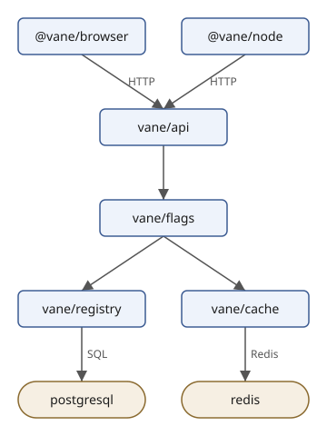
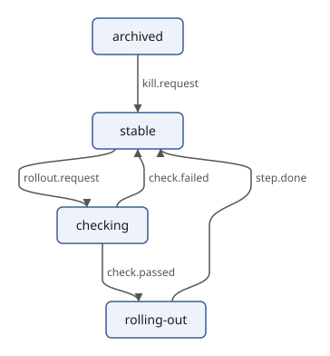

# Drawing with XSLT

<!-- examples: svg -->

XQuery computed the layout and wrote the drawing in one go. The drawing
half is also a natural job for XSLT: each kind of element in the input
becomes a piece of SVG, which is exactly what template rules say. In
this section a stylesheet draws the diagram from the layout that
`layout.xq` writes, and it draws the edge labels last, on top of
everything, which the XQuery drawing doesn't do.

## The input: a laid-out diagram

The stylesheet does no layout of its own. It reads the description
with the layout added, which
[Computing a Layout](svg-layout.md) made with `layout.xq`:

```console
$ sxml xquery --context-item=diagram.xml --output=laid-out.xml layout.xq
$ sxml xpath --context-item=laid-out.xml '/diagram/@width/string(), //node[@id = "redis"]/@*!string()'
"299"
"redis"
"redis"
"store"
"177"
"356"
"100"
"40"
```

## The stylesheet

`draw.xsl`:

```xml
{{#include ../examples/svg/draw.xsl}}
```

Read it from the top.

- `xmlns="http://www.w3.org/2000/svg"` on the stylesheet makes it the
  default namespace of the *literal result elements*: `svg`, `g`, `rect`
  and the others are written in the SVG namespace. It does not change
  what the patterns and paths mean: `match="node"` and `select="edge"`
  still name elements in no namespace, as in the input. (XSLT keeps the
  two apart; XQuery's `declare default element namespace` changes both.)
- `expand-text="yes"` turns on *text value templates*: curly braces in
  text hold expressions, as `{@title}` and `{@label}` do. Braces in
  attributes are *attribute value templates*, which XSLT always has. In
  the style rules a brace that is CSS is doubled, the same rule as in
  XQuery. The text of `style` is copied as it is written, indentation
  included; CSS doesn't mind.
- `xsl:output indent="yes"` asks for one element per line.

## One mode per layer

The template for `/diagram` writes the frame (title, style, the arrow
marker) and three groups, and it fills each group by applying templates
in a different *mode*: `edges`, `nodes` and `labels`. A mode is a
separate set of template rules, so the same `edge` elements are
processed twice, once to draw their paths and once to write their
labels, by different rules. The order of the groups is the order of
drawing: paths first, then the boxes, then the labels over both, where
no box can hide them.

Within a mode the most specific rule wins. In the `labels` mode,
`edge[@label]` has a predicate, which gives it the default priority 0.5,
and `edge` alone has priority 0; so an edge with a label is written by
the first rule, and one without falls to the second, which is empty and
writes nothing.

## `xsl:next-match` for stores

A store is a node with rounder corners. Instead of a second copy of the
node rule, the store rule hands the work back: `xsl:next-match` applies
the next rule that matches, here the general `node` rule, and
`xsl:with-param` gives it the corner radius. The general rule declares
the parameter with its default, 6:

```console
$ sxml transform draw.xsl laid-out.xml --output=drawn.svg
$ sxml xpath --context-item=drawn.svg '//*:g[@id = ("node-cache", "node-redis")] ! `{@id}: {@class}, rx {*:rect/@rx}`'
"node-cache: service, rx 6"
"node-redis: store, rx 20"
```



The cache module is a box like the other modules; Redis, where it keeps
its data, is the store.

The class is an attribute value template with a sequence in it,
`{(@kind, 'service')[1], @class}`: the values are joined with spaces, and
a missing `class` adds nothing.

## The result

```console
$ sxml transform draw.xsl laid-out.xml
<?xml version="1.0" encoding="UTF-8"?>
<svg xmlns="http://www.w3.org/2000/svg" width="299" height="416" viewBox="0 0 299 416">
  <title>Vane</title>
  <style>
        .nodes rect { fill: #eef3fb; stroke: #3b5b92; stroke-width: 1.5 }
        .nodes .store rect { fill: #f6efe3; stroke: #8a6a2f }
        .nodes text { font: 14px sans-serif; fill: #1b1b1b }
        .edges path { fill: none; stroke: #555555; stroke-width: 1.5 }
        .labels text { font: 12px sans-serif; fill: #555555 }
      </style>
  <defs>
    <marker id="arrow" viewBox="0 0 10 10" refX="10" refY="5" markerWidth="9" markerHeight="9" markerUnits="userSpaceOnUse" orient="auto">
      <path d="M 0 0 L 10 5 L 0 10 z" fill="#555555"/>
    </marker>
  </defs>
  <g class="edges">
    <path id="edge-browser-api" d="M 83 60 C 83 72, 123 72, 123 84 L 123 100 C 123 112, 138 112, 138 124" marker-end="url(#arrow)"/>
    <path id="edge-node-api" d="M 227 60 C 227 72, 187 72, 187 84 L 187 100 C 187 112, 171 112, 171 124" marker-end="url(#arrow)"/>
    <path id="edge-api-flags" d="M 155 164 C 155 176, 155 176, 155 188" marker-end="url(#arrow)"/>
    <path id="edge-flags-registry" d="M 138 228 C 138 240, 83 240, 83 252" marker-end="url(#arrow)"/>
    <path id="edge-flags-cache" d="M 172 228 C 172 240, 227 240, 227 252" marker-end="url(#arrow)"/>
    <path id="edge-registry-postgresql" d="M 83 292 C 83 304, 83 304, 83 316 L 83 332 C 83 344, 83 344, 83 356" marker-end="url(#arrow)"/>
    <path id="edge-cache-redis" d="M 227 292 C 227 304, 227 304, 227 316 L 227 332 C 227 344, 227 344, 227 356" marker-end="url(#arrow)"/>
  </g>
  <g class="nodes">
    <g id="node-browser" class="service">
      <rect x="20" y="20" width="126" height="40" rx="6"/>
      <text x="83" y="45" text-anchor="middle">@vane/browser</text>
    </g>
    <g id="node-node" class="service">
      <rect x="176" y="20" width="102" height="40" rx="6"/>
      <text x="227" y="45" text-anchor="middle">@vane/node</text>
    </g>
    <g id="node-api" class="service">
      <rect x="105" y="124" width="100" height="40" rx="6"/>
      <text x="155" y="149" text-anchor="middle">vane/api</text>
    </g>
    <g id="node-flags" class="service">
      <rect x="104" y="188" width="102" height="40" rx="6"/>
      <text x="155" y="213" text-anchor="middle">vane/flags</text>
    </g>
    <g id="node-registry" class="service">
      <rect x="20" y="252" width="126" height="40" rx="6"/>
      <text x="83" y="277" text-anchor="middle">vane/registry</text>
    </g>
    <g id="node-cache" class="service">
      <rect x="176" y="252" width="102" height="40" rx="6"/>
      <text x="227" y="277" text-anchor="middle">vane/cache</text>
    </g>
    <g id="node-postgresql" class="store">
      <rect x="32" y="356" width="102" height="40" rx="20"/>
      <text x="83" y="381" text-anchor="middle">postgresql</text>
    </g>
    <g id="node-redis" class="store">
      <rect x="177" y="356" width="100" height="40" rx="20"/>
      <text x="227" y="381" text-anchor="middle">redis</text>
    </g>
  </g>
  <g class="labels">
    <text x="128" y="96">HTTP</text>
    <text x="192" y="96">HTTP</text>
    <text x="88" y="328">SQL</text>
    <text x="232" y="328">Redis</text>
  </g>
</svg>
```

The labels layer has four texts, not seven: the three edges between
modules have no label, and the empty rule writes nothing for them. The
boxes, paths and labels are where the XQuery drawing has them; only the
grouping and the style differ. Arithmetic on attributes works because
an attribute of an untyped document is untyped: `@x + @width idiv 2`
converts both to numbers. The two steps also run as one pipeline, the layout's output
read by the stylesheet from standard input (`-`):

```console
$ sxml xquery --context-item=states.xml layout.xq | sxml transform draw.xsl - --output=states.svg
$ sxml xpath --context-item=states.svg '//*:g[@class = "labels"]/*:text ! `{.} at {@x},{@y}`'
"rollout.request at 26,200"
"check.passed at 118,304"
"check.failed at 164,200"
"step.done at 282,200"
"kill.request at 157,96"
```



## A rule for input that is wrong

Given the description itself, without the layout, the rules above would
write a drawing with empty sizes and no places, and say nothing. One
more rule catches that: `/diagram[not(@width)]` matches a diagram
without a layout, and `xsl:message terminate="yes"` stops the
transformation with the message. Both patterns, `/diagram` and
`/diagram[not(@width)]`, have the default priority 0.5, so the rule
gives itself `priority="1"` to win:

```console
$ sxml transform draw.xsl diagram.xml
Vane: no layout; run layout.xq first
draw.xsl:41:5: err:XTMM9000: Vane: no layout; run layout.xq first
```

## Matching SVG

So far the stylesheet *wrote* SVG and *read* elements in no namespace.
A stylesheet that reads SVG must match SVG names, and the attribute
`xpath-default-namespace` says which namespace unprefixed names in
patterns and paths are in. This one lists the boxes of any drawing:

`boxes.xsl`:

```xml
{{#include ../examples/svg/boxes.xsl}}
```

Run on both drawings, it shows that they agree:

```console
$ sxml transform boxes.xsl diagram.svg
20,20 @vane/browser
176,20 @vane/node
105,124 vane/api
104,188 vane/flags
20,252 vane/registry
176,252 vane/cache
32,356 postgresql
177,356 redis
$ sxml transform boxes.xsl drawn.svg
20,20 @vane/browser
176,20 @vane/node
105,124 vane/api
104,188 vane/flags
20,252 vane/registry
176,252 vane/cache
32,356 postgresql
177,356 redis
```

Without `xpath-default-namespace`, `//rect` would look for `rect` in no
namespace, find nothing, and the output would be empty. The next
section is all about stylesheets like this one, which read drawings and
write changed ones.
