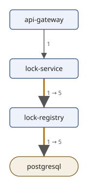
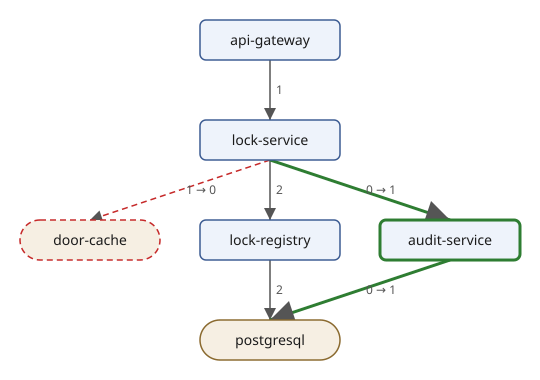

# Rendering the Diff

<!-- examples: traces -->

Text and JSON are right for tools; people reviewing a change want a
page they can read and a picture. In this section the diff becomes an
HTML report, written by an XSLT stylesheet, and a diagram of the
services in each route, drawn by the drawing module of [Project:
Drawing Diagrams with SVG](svg.md).

## The diff as XML

XSLT works on trees, so the first step is the diff as XML. The records
of `trace:diff` and `trace:versions` become elements with one attribute
per field; a field that is empty becomes no attribute:

`diff-xml.xq`:

```xquery
{{#include ../examples/traces/diff-xml.xq}}
```

```console
$ sxml xquery --output=diff.xml diff-xml.xq
$ cat diff.xml
<diff before="before.json" after="after.json">
  <version service="lock-service" before="2.3.0" after="2.4.0"/>
  <version service="audit-service" after="0.3.1"/>
  <change route="GET /doors" caller="lock-registry" callee="postgresql" before="1" after="5"/>
  <change route="GET /doors" caller="lock-service" callee="lock-registry" before="1" after="5"/>
  <change route="POST /doors/{id}/unlock" caller="audit-service" callee="postgresql" before="0" after="1"/>
  <change route="POST /doors/{id}/unlock" caller="lock-service" callee="audit-service" before="0" after="1"/>
  <change route="POST /doors/{id}/unlock" caller="lock-service" callee="door-cache" before="1" after="0"/>
</diff>
```

## An HTML report

The report has a table of versions and a table of changes for each
route. `xsl:for-each-group` makes the routes; a template rule for each
kind of change sets the row's class, which the page's style colours:

`report.xsl`:

```xml
{{#include ../examples/traces/report.xsl}}
```

A row for an added call matches both `change` and `change[@before =
0]`. The second rule has the higher priority and wins; it passes the
kind on with `xsl:next-match`, which runs the next best rule, the
general one, with the parameter. The braces in the style are doubled
because `expand-text="yes"` makes single braces text value templates.

```console
$ sxml transform report.xsl diff.xml
<!DOCTYPE html>
<html>
  <head>
    <meta charset="UTF-8">
    <title>Trace diff: before.json and after.json</title>
    <style>
          td, th { padding: 2px 12px; text-align: left }
          .added { color: #2e7d32 }
          .removed { color: #c62828; text-decoration: line-through }
          .changed { color: #b26a00 }
        </style>
  </head>
  <body>
    <h1>Trace diff</h1>
    <p>From <code>before.json</code> to <code>after.json</code>.</p>
    <h2>Versions</h2>
    <table>
      <tr>
        <th>Service</th>
        <th>Before</th>
        <th>After</th>
      </tr>
      <tr>
        <td>lock-service</td>
        <td>2.3.0</td>
        <td>2.4.0</td>
      </tr>
      <tr>
        <td>audit-service</td>
        <td>none</td>
        <td>0.3.1</td>
      </tr>
    </table>
    <h2>GET /doors</h2>
    <table>
      <tr>
        <th>Caller</th>
        <th>Callee</th>
        <th>Before</th>
        <th>After</th>
      </tr>
      <tr class="changed">
        <td>lock-registry</td>
        <td>postgresql</td>
        <td>1</td>
        <td>5</td>
      </tr>
      <tr class="changed">
        <td>lock-service</td>
        <td>lock-registry</td>
        <td>1</td>
        <td>5</td>
      </tr>
    </table>
    <h2>POST /doors/{id}/unlock</h2>
    <table>
      <tr>
        <th>Caller</th>
        <th>Callee</th>
        <th>Before</th>
        <th>After</th>
      </tr>
      <tr class="added">
        <td>audit-service</td>
        <td>postgresql</td>
        <td>0</td>
        <td>1</td>
      </tr>
      <tr class="added">
        <td>lock-service</td>
        <td>audit-service</td>
        <td>0</td>
        <td>1</td>
      </tr>
      <tr class="removed">
        <td>lock-service</td>
        <td>door-cache</td>
        <td>1</td>
        <td>0</td>
      </tr>
    </table>
  </body>
</html>
```

## The services as a diagram

The drawing module of the SVG project draws any `diagram` of nodes and
edges, and a `class` on a node or an edge marks it as `added`,
`removed` or `changed`. It lives in the SVG project's directory, and
`draw.xqm` here is a symbolic link to `../svg/draw.xqm`, so both
projects use the same file.

`participants.xq` makes the diagram of one route: a node for each
service that takes part in it, before or after, and an edge for each
call between two of them, labelled with its count. What only the new
file has is `added`, what only the old one has is `removed`, and a call
whose count changed is `changed`. A callee that recorded no spans of
its own is drawn as a store:

`participants.xq`:

```xquery
{{#include ../examples/traces/participants.xq}}
```

```console
$ sxml xquery '--param=route=POST /doors/{id}/unlock' --output=unlock.xml participants.xq
$ cat unlock.xml
<diagram title="POST /doors/{id}/unlock: before.json and after.json">
  <node id="api-gateway" label="api-gateway"/>
  <node id="lock-service" label="lock-service"/>
  <node id="door-cache" label="door-cache" kind="store" class="removed"/>
  <node id="lock-registry" label="lock-registry"/>
  <node id="postgresql" label="postgresql" kind="store"/>
  <node id="audit-service" label="audit-service" class="added"/>
  <edge from="api-gateway" to="lock-service" label="1"/>
  <edge from="lock-service" to="door-cache" label="1 → 0" class="removed"/>
  <edge from="lock-service" to="lock-registry" label="2"/>
  <edge from="lock-registry" to="postgresql" label="2"/>
  <edge from="lock-service" to="audit-service" label="0 → 1" class="added"/>
  <edge from="audit-service" to="postgresql" label="0 → 1" class="added"/>
</diagram>
```

`drawing.xq` draws a diagram with the module:

`drawing.xq`:

```xquery
{{#include ../examples/traces/drawing.xq}}
```

The drawings of both routes are in the project directory, and
drawing them again gives the same files:

```console
$ sxml xquery --context-item=unlock.xml --output=unlock.svg drawing.xq
$ cmp unlock.svg diff-unlock.svg && echo same
same
$ sxml xquery --output=doors.xml participants.xq
$ sxml xquery --context-item=doors.xml --output=doors.svg drawing.xq
$ cmp doors.svg diff-doors.svg && echo same
same
```

Listing the doors:



Unlocking a door:



## The drawings in the report

An HTML page can hold SVG directly. With the parameter `drawings`, a
list of SVG files, `report.xsl` copies into each route's section the
drawing whose title begins with the route, so the report becomes one
file with everything in it:

```console
$ sxml transform --param='drawings=diff-doors.svg diff-unlock.svg' --output=report.html report.xsl diff.xml
$ sxml xpath 'count(html-doc("report.html")//*:svg)'
2
```

The stylesheet reads the drawings with `doc()`, as XML files;
`html-doc` reads the HTML page back, with the SVG elements in their own
namespace, as a browser does. Open `report.html` in a browser to see
the tables and the two drawings.
