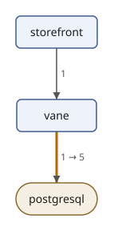
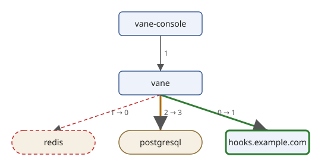

# Rendering the Diff

<!-- examples: traces -->

Text and JSON are right for tools; people reviewing a change want a
page they can read and a picture. In this section the diff becomes an
HTML report, written by an XSLT stylesheet, and a diagram of the
participants of each route, drawn by the drawing module of [Project:
Drawing Diagrams with SVG](svg.md).

## The diff as XML

XSLT works on trees, so the first step is the diff as XML. The records
of `trace:diff` and `trace:versions` become elements with one attribute
per field; a field that is empty becomes no attribute:

`diff-xml.xq`:

```xquery
{{#include ../examples/traces/diff-xml.xq}}
```

```console
$ sxml xquery --output=diff.xml diff-xml.xq
$ cat diff.xml
<diff before="before.json" after="after.json">
  <version service="vane" before="2.3.0" after="2.4.0"/>
  <change route="GET /api/getFlags" caller="vane" callee="postgresql" before="1" after="5"/>
  <change route="POST /api/killFlag" caller="vane" callee="hooks.example.com" before="0" after="1"/>
  <change route="POST /api/killFlag" caller="vane" callee="postgresql" before="2" after="3"/>
  <change route="POST /api/killFlag" caller="vane" callee="redis" before="1" after="0"/>
</diff>
```

## An HTML report

The report has a table of versions and a table of changes for each
route. `xsl:for-each-group` makes the routes; a template rule for each
kind of change sets the row's class, which the page's style colours:

`report.xsl`:

```xml
{{#include ../examples/traces/report.xsl}}
```

A row for an added call matches both `change` and `change[@before =
0]`. The second rule has the higher priority and wins; it passes the
kind on with `xsl:next-match`, which runs the next best rule, the
general one, with the parameter. The braces in the style are doubled
because `expand-text="yes"` makes single braces text value templates.

```console
$ sxml transform report.xsl diff.xml
<!DOCTYPE html>
<html>
  <head>
    <meta charset="UTF-8">
    <title>Trace diff: before.json and after.json</title>
    <style>
          td, th { padding: 2px 12px; text-align: left }
          .added { color: #2e7d32 }
          .removed { color: #c62828; text-decoration: line-through }
          .changed { color: #b26a00 }
        </style>
  </head>
  <body>
    <h1>Trace diff</h1>
    <p>From <code>before.json</code> to <code>after.json</code>.</p>
    <h2>Versions</h2>
    <table>
      <tr>
        <th>Service</th>
        <th>Before</th>
        <th>After</th>
      </tr>
      <tr>
        <td>vane</td>
        <td>2.3.0</td>
        <td>2.4.0</td>
      </tr>
    </table>
    <h2>GET /api/getFlags</h2>
    <table>
      <tr>
        <th>Caller</th>
        <th>Callee</th>
        <th>Before</th>
        <th>After</th>
      </tr>
      <tr class="changed">
        <td>vane</td>
        <td>postgresql</td>
        <td>1</td>
        <td>5</td>
      </tr>
    </table>
    <h2>POST /api/killFlag</h2>
    <table>
      <tr>
        <th>Caller</th>
        <th>Callee</th>
        <th>Before</th>
        <th>After</th>
      </tr>
      <tr class="added">
        <td>vane</td>
        <td>hooks.example.com</td>
        <td>0</td>
        <td>1</td>
      </tr>
      <tr class="changed">
        <td>vane</td>
        <td>postgresql</td>
        <td>2</td>
        <td>3</td>
      </tr>
      <tr class="removed">
        <td>vane</td>
        <td>redis</td>
        <td>1</td>
        <td>0</td>
      </tr>
    </table>
  </body>
</html>
```

## The participants as a diagram

The drawing module of the SVG project draws any `diagram` of nodes and
edges, and a `class` on a node or an edge marks it as `added`,
`removed` or `changed`. It lives in the SVG project's directory, and
`draw.xqm` here is a symbolic link to `../svg/draw.xqm`, so both
projects use the same file.

`participants.xq` makes the diagram of one route: a node for each
participant, before or after, and an edge for each call between two of
them, labelled with its count. What only the new file has is `added`,
what only the old one has is `removed`, and a call whose count changed
is `changed`. A database is drawn as a store: a callee that some client
span marks with `db`. The owners' webhook records no spans of its own
either, but it is a web server, not a database, so it is drawn as a box
like the programs:

`participants.xq`:

```xquery
{{#include ../examples/traces/participants.xq}}
```

```console
$ sxml xquery '--param=route=POST /api/killFlag' --output=kill.xml participants.xq
$ cat kill.xml
<diagram title="POST /api/killFlag: before.json and after.json">
  <node id="vane-console" label="vane-console"/>
  <node id="vane" label="vane"/>
  <node id="redis" label="redis" kind="store" class="removed"/>
  <node id="postgresql" label="postgresql" kind="store"/>
  <node id="hooks.example.com" label="hooks.example.com" class="added"/>
  <edge from="vane-console" to="vane" label="1"/>
  <edge from="vane" to="redis" label="1 → 0" class="removed"/>
  <edge from="vane" to="postgresql" label="2 → 3" class="changed"/>
  <edge from="vane" to="hooks.example.com" label="0 → 1" class="added"/>
</diagram>
```

`drawing.xq` draws a diagram with the module:

`drawing.xq`:

```xquery
{{#include ../examples/traces/drawing.xq}}
```

The drawings of both routes are in the project directory, and
drawing them again gives the same files:

```console
$ sxml xquery --context-item=kill.xml --output=kill.svg drawing.xq
$ cmp kill.svg diff-kill.svg && echo same
same
$ sxml xquery --output=flags.xml participants.xq
$ sxml xquery --context-item=flags.xml --output=flags.svg drawing.xq
$ cmp flags.svg diff-flags.svg && echo same
same
```

Listing the flags:



Killing a flag:



The modules of the service are not in the drawings: a call from one
module to another is a function call inside the one program, and its
internal span is not a call. The drawings show what crosses the
network, and that is where this change shows: more queries, a cache
that is no longer read, and a new webhook.

## The drawings in the report

An HTML page can hold SVG directly. With the parameter `drawings`, a
list of SVG files, `report.xsl` copies into each route's section the
drawing whose title begins with the route, so the report becomes one
file with everything in it:

```console
$ sxml transform --param='drawings=diff-flags.svg diff-kill.svg' --output=report.html report.xsl diff.xml
$ sxml xpath 'count(html-doc("report.html")//*:svg)'
2
```

The stylesheet reads the drawings with `doc()`, as XML files;
`html-doc` reads the HTML page back, with the SVG elements in their own
namespace, as a browser does. Open `report.html` in a browser to see
the tables and the two drawings.
